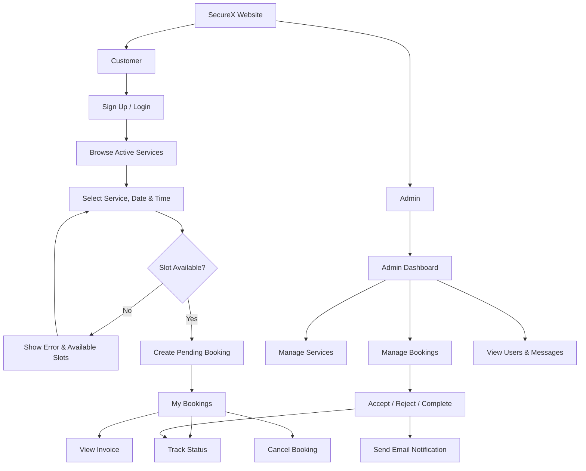

<div align="center">

# 🛡️ SecureX

### CCTV Security Service Booking & Management System

একটি আধুনিক web application যেখানে গ্রাহক security service খুঁজতে, নির্দিষ্ট date ও time slot-এ booking করতে এবং booking status track করতে পারেন। Admin একটি central dashboard থেকে services, bookings, users ও customer messages পরিচালনা করতে পারেন।

[](https://laravel.com)
[](https://www.php.net)
[](https://www.mysql.com)
[](https://getbootstrap.com)
[](https://vite.dev)

[Features](#-key-features) · [Workflow](#-system-workflow) · [Installation](#-installation) · [Configuration](#-configuration) · [Project Structure](#-project-structure)

</div>

---

## 📖 About SecureX

SecureX একটি role-based CCTV security service platform। এখানে visitor available services ও website information দেখতে পারেন, registered customer online booking করতে পারেন এবং admin পুরো service operation পরিচালনা করতে পারেন।

এই project-এ authentication, Google OAuth, booking slot validation, invoice authorization, email notification, service CRUD এবং administrative reporting—সবকিছু একটি integrated system হিসেবে কাজ করে।

## ✨ Key Features

### 👤 Customer Features

- Email ও password দিয়ে account registration এবং login
- Google account দিয়ে দ্রুত sign up/login
- Remember Me ও secure session-based authentication
- Active security services, description এবং price দেখা
- Service, future date এবং predefined time slot নির্বাচন করে booking
- Confirmed slot duplicate হলে available slot suggestion
- নিজের booking history ও বর্তমান status দেখা
- Booking invoice দেখা ও নিজের booking cancel করা
- Booking status পরিবর্তন হলে email notification পাওয়া
- Contact/quote request পাঠানো

### 🧑‍💼 Admin Features

- Role-protected admin dashboard
- Users, services, bookings ও messages-এর statistical summary
- Recent bookings এবং recent contact messages দেখা
- Service create, edit, activate/deactivate ও delete করা
- সব customer booking দেখা
- Booking Accept, Reject অথবা Complete করা
- Invalid booking-status transition প্রতিরোধ
- Status update-এর সঙ্গে customer email notification
- Registered users ও contact messages দেখা

### 🔐 Security & Validation

- Password hashing, CSRF protection ও secure session management
- Authentication ও admin middleware
- Unique email ও phone validation
- Booking owner/admin ছাড়া invoice access নিষিদ্ধ
- Past-date ও unavailable-slot booking প্রতিরোধ
- Server-side form validation
- Controlled booking-status transitions

## 🧭 System Workflow



Editable Draw.io diagram: [`system-flowchart.drawio`](system-flowchart.drawio)

## 🔄 Booking Lifecycle

```text
Pending ─────► Accepted ─────► Completed
   │
   └────────► Rejected

Customer ───► Canceled
```

| Current status | Allowed next status | Performed by |
|---|---|---|
| `pending` | `accepted`, `rejected` | Admin |
| `accepted` | `completed` | Admin |
| Active customer booking | `canceled` | Booking owner |
| `rejected` / `completed` | No further admin update | System protected |

## 🕘 Available Booking Slots

| Slot | Time |
|:---:|:---:|
| 01 | 09:00 AM |
| 02 | 11:00 AM |
| 03 | 01:00 PM |
| 04 | 03:00 PM |
| 05 | 05:00 PM |

## 🛠️ Technology Stack

| Layer | Technology |
|---|---|
| Backend | PHP 8.2+, Laravel 12 |
| Frontend | Blade, Bootstrap, CSS, JavaScript |
| Build tool | Vite 7 |
| Database | MySQL or SQLite |
| Authentication | Laravel Auth, Laravel Socialite |
| Social login | Google OAuth 2.0 |
| Alerts | RealRashid SweetAlert |
| Email | Laravel Mail |
| Testing | PHPUnit 11 |

## ✅ Requirements

- PHP `8.2` বা নতুন version
- Composer
- Node.js ও npm
- MySQL/MariaDB অথবা SQLite
- প্রয়োজনীয় PHP extensions: `ctype`, `curl`, `dom`, `fileinfo`, `filter`, `hash`, `mbstring`, `openssl`, `pcre`, `pdo`, `session`, `tokenizer`, `xml`

## 🚀 Installation

### 1. Repository clone করুন

```bash
git clone https://github.com/nazmusshakib878/Securex.git
cd Securex
```

### 2. Dependencies install করুন

```bash
composer install
npm install
```

### 3. Environment file ও application key তৈরি করুন

Windows PowerShell:

```powershell
Copy-Item .env.example .env
php artisan key:generate
```

Linux/macOS:

```bash
cp .env.example .env
php artisan key:generate
```

### 4. Database configure করুন

SQLite ব্যবহার করলে `database/database.sqlite` file তৈরি করে `.env`-এ রাখুন:

```env
DB_CONNECTION=sqlite
```

MySQL ব্যবহার করলে database তৈরি করে `.env` update করুন:

```env
DB_CONNECTION=mysql
DB_HOST=127.0.0.1
DB_PORT=3306
DB_DATABASE=securex
DB_USERNAME=root
DB_PASSWORD=
```

### 5. Database migrate ও frontend build করুন

```bash
php artisan migrate
npm run build
```

### 6. Development server চালু করুন

```bash
php artisan serve
```

তারপর browser-এ খুলুন: **http://127.0.0.1:8000**

সব development process একসঙ্গে চালাতে:

```bash
composer run dev
```

## ⚙️ Configuration

### Google OAuth

Google Cloud Console-এ OAuth client তৈরি করে authorized redirect URI দিন:

```text
http://localhost:8000/auth/google/callback
```

`.env` update করুন:

```env
GOOGLE_CLIENT_ID=your_google_client_id
GOOGLE_CLIENT_SECRET=your_google_client_secret
GOOGLE_REDIRECT_URI=http://localhost:8000/auth/google/callback
```

Google credentials ছাড়াও সাধারণ email/password authentication ব্যবহার করা যাবে।

### Email Notification

Local development-এ email log করতে:

```env
MAIL_MAILER=log
MAIL_FROM_ADDRESS="hello@example.com"
MAIL_FROM_NAME="${APP_NAME}"
```

SMTP ব্যবহার করতে provider অনুযায়ী values দিন:

```env
MAIL_MAILER=smtp
MAIL_HOST=your_smtp_host
MAIL_PORT=587
MAIL_USERNAME=your_username
MAIL_PASSWORD=your_password
MAIL_ENCRYPTION=tls
MAIL_FROM_ADDRESS="no-reply@example.com"
MAIL_FROM_NAME="SecureX"
```

> [!IMPORTANT]
> `.env`, database password, Google secret এবং SMTP password কখনো GitHub-এ commit করবেন না।

## 🗂️ Project Structure

```text
Securex/
├── app/
│   ├── Http/Controllers/       # Authentication, booking, service & admin logic
│   ├── Http/Middleware/        # Admin access protection
│   ├── Mail/                   # Booking status email
│   └── Models/                 # Application data models
├── database/
│   ├── migrations/             # Database schema
│   └── seeders/
├── public/site/                # Public CSS, JS, images & libraries
├── resources/views/            # Blade pages and layouts
├── routes/web.php              # Web routes
├── tests/                      # Automated tests
├── system-flowchart.drawio     # Editable system flowchart
├── composer.json
└── package.json
```

## 🗃️ Main Database Entities

| Entity | Purpose |
|---|---|
| `users` | Customer/admin account ও role information |
| `services` | Service title, image, description, price ও availability |
| `bookings` | Customer, service, schedule, price, message ও status |
| `contact_messages` | Customer inquiry/quote request ও related service |

## 🧪 Testing

Automated test ও production build যাচাই করতে:

```bash
composer test
npm run build
```

## 👥 User Roles

| Capability | Visitor | Customer | Admin |
|---|:---:|:---:|:---:|
| Browse services | ✅ | ✅ | ✅ |
| Send contact message | ✅ | ✅ | ✅ |
| Create booking | ❌ | ✅ | ✅ |
| View/cancel own bookings | ❌ | ✅ | — |
| View own invoice | ❌ | ✅ | — |
| View dashboard | ❌ | ❌ | ✅ |
| Manage services | ❌ | ❌ | ✅ |
| Manage booking status | ❌ | ❌ | ✅ |
| View users/messages | ❌ | ❌ | ✅ |

## 🤝 Contributing

1. Repository fork করুন
2. Feature branch তৈরি করুন: `git checkout -b feature/feature-name`
3. পরিবর্তন commit করুন: `git commit -m "Add feature name"`
4. Branch push করুন: `git push origin feature/feature-name`
5. একটি Pull Request খুলুন

## 🐞 Reporting Issues

Bug report বা feature request-এর জন্য repository-এর [Issues](https://github.com/nazmusshakib878/Securex/issues) section ব্যবহার করুন। Expected result, actual result এবং reproduction steps যোগ করলে issue সমাধান করা সহজ হবে।

## 📄 License

এই project Laravel framework-এর উপর তৈরি। Project ব্যবহারের আগে repository owner-এর অনুমতি ও প্রযোজ্য license terms অনুসরণ করুন।

## 👨‍💻 Author

**Nazmus Shakib**

- GitHub: [@nazmusshakib878](https://github.com/nazmusshakib878)
- Repository: [SecureX](https://github.com/nazmusshakib878/Securex)

---

<div align="center">

### ⭐ Project-টি ভালো লাগলে repository-তে একটি star দিতে পারেন!

Made with ❤️ using Laravel

</div>
